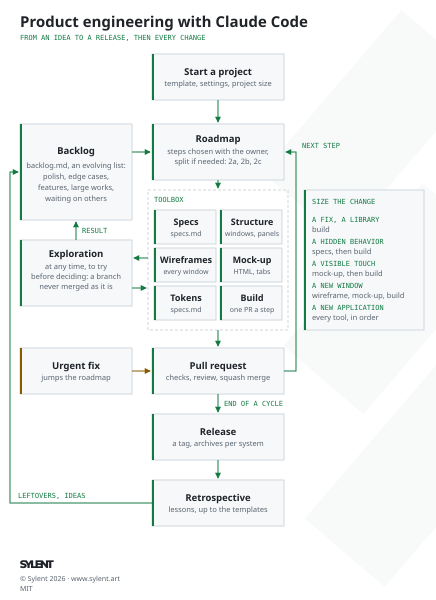

# rust-desktop-template

Template for Rust desktop applications (egui and eframe), with the project conventions, the process from an idea to a release, and the Claude Code setup. Made from [rust-cli-template](https://github.com/sylent-dev/rust-cli-template), its command-line counterpart, with what [Exile Market](https://github.com/sylent-dev/rust-exile-market) taught.



## What it contains

| File | Content |
|---|---|
| `process.md`, `docs/process.svg`, `docs/process-light.svg` | How an application goes from an idea to a release and keeps growing: a toolbox (specifications, structure, wireframes, mock-up and design system, build, release, retrospective) picked for each change, a backlog and a roadmap, the urgent fixes and the explorations, with its diagram, dark and light (the README and `process.md` show the light one). |
| `design-journal.md` | The design experiences of past applications: choices kept and rejected, and why. A source of ideas, not rules. |
| `CLAUDE.md` | Rules for Claude Code: communication, naming, language, specifications and roadmap, interface design, lessons, Git workflow, commit messages, code review, checks, releases. |
| `.claude/agents/code-reviewer.md` | Subagent that reviews a branch before its pull request and writes its notes, in French, to `outputs/`. |
| `.claude/agents/security-auditor.md` | Subagent that audits the security of the whole repository before a release and writes its findings, in French, to `outputs/`. |
| `.claude/agents/dependency-reviewer.md` | Subagent that reviews the open Dependabot pull requests and tells, in French, which to merge or set aside, with their links and the comments to post. |
| `.claude/skills/excalidraw-wireframes/` | Skill: editable Excalidraw wireframes of the interface, and sketches of a structure, iterated with the owner (Python helpers and an SVG preview). |
| `.claude/skills/html-mockups/` | Skill: the HTML mock-up built from the wireframe, styles and open decisions compared with tabs, then the design tokens (starting page, server without cache, headless screenshots). |
| `specs.md` | Skeleton of the specifications: what the application does. |
| `roadmap.md`, `backlog.md` | Skeletons of the roadmap (the size of the project and the steps chosen, one pull request per step, kept short since it is read at every session) and of the backlog (polish, edge cases, features, large works, waiting on others). |
| `src/` | A window drawn with egui: one text translated, the language of the system or the one chosen, and a setting of the window level; `src/i18n.rs` (Fluent), `src/settings.rs` (TOML, saved atomically by `src/files.rs`). |
| `locales/` | The messages of the interface, one Fluent file per language (`en.ftl`, the reference, and `fr.ftl`). |
| `docs/technical-choices.md` | The technical choices and their reasons: egui and eframe, X11 on Linux, Fluent, the settings, the releases. |
| `docs/releases.md` | How to publish a version, and what its archives hold. |
| `docs/lessons.md`, `docs/tests/` | The lessons kept for the retrospectives, and the guides of the tests by hand. |
| `.claude/settings.json` | Project settings of Claude Code: the claude.ai connectors turned off and the unused skills hidden from the model, to save tokens. |
| `Cargo.toml`, `clippy.toml` | Package and executable, `unsafe` code forbidden, Clippy pedantic lints and `unwrap` outside the tests, optimized release profile. |
| `rust-toolchain.toml` | The version of Rust, pinned, with `rustfmt` and Clippy. |
| `.github/workflows/ci.yml` | Format, lint and test on every pull request, Clippy on Windows and for macOS, and a check with the minimum Rust version (`rust-version`); skipped for a documentation change. |
| `.github/workflows/release.yml` | Windows, macOS and Linux archives published as a GitHub release on version tags from `main`, with the licenses of the dependencies and the checksums. |
| `.github/workflows/advisories.yml`, `deny.toml`, `about.toml`, `about.hbs` | The security advisories of the dependencies every day, and their licenses checked and listed at each release. |
| `.github/scripts/`, `scripts/` | The checks of the CI: a documentation change, the actions pinned to a commit, the clipboard of the system reached by egui, Clippy for macOS from Linux. |
| `.github/dependabot.yml` | Weekly pull requests to update the crates, the GitHub Actions and the version of Rust. |
| `LICENSE-MIT`, `LICENSE-APACHE` | Dual license, the Rust ecosystem default. |
| `inputs/`, `outputs/` | Untracked working folders: temporary references given to Claude Code, and temporary files it produces (see `CLAUDE.md`). |

## Start a new project

1. Create the repository from this template, with the **Use this template** button or:

   ```sh
   gh repo create <name> --template sylent-dev/rust-desktop-template --private --clone
   ```

2. In `Cargo.toml`, update `name`, `description`, `repository` and the `[[bin]]` name (the executable, the application id of the window and the folder of the settings), then run `cargo build` to update `Cargo.lock`. In `src/main.rs`, update `APP_NAME` and the test of the executable name.
3. Adapt this README to the project: keep the Requirements, Build, Development, Release and License sections, replace the others.
4. Check the license: keep `MIT OR Apache-2.0`, or change `license` in `Cargo.toml` and the `LICENSE-*` files (they are also copied into the release archives by `.github/workflows/release.yml`).
5. On GitHub, protect `main` (**Settings › Rules › Rulesets**): require a pull request and the `Format, lint and test`, `Lint on windows-latest`, `Lint on macos-latest` and `Minimum Rust version` checks; protect the tags `v*` from being moved or deleted (docs/releases.md). On a free account, rulesets only apply to public repositories.
6. Set the pull request settings, which are not copied from the template: allow only squash merging, and delete the branches once merged (**Settings › General › Pull Requests**), or:

   ```sh
   gh repo edit --enable-squash-merge --enable-merge-commit=false --enable-rebase-merge=false --delete-branch-on-merge
   ```

7. With Claude Code, follow [process.md](process.md): size the project, write `specs.md`, then split it into steps in `roadmap.md`, and confirm the choices of `docs/technical-choices.md`.

## Requirements

- Rust 1.95 or later (the version of `rust-toolchain.toml` is installed by rustup)
- On Linux, an X11 session or XWayland, and OpenGL

## Build

```sh
cargo build --release
cargo run
```

## Development

```sh
cargo fmt --all
cargo clippy --workspace --all-targets --all-features -- -D warnings
cargo test --workspace --all-features
sh scripts/clippy-macos.sh
```

## Release

Follow [docs/releases.md](docs/releases.md): the version in `Cargo.toml`, the notes in `docs/release-notes/v<version>.md`, a build by hand of every system, then the tag:

```sh
git switch main && git pull
git tag v0.1.0
git push origin v0.1.0
```

The [Release workflow](.github/workflows/release.yml) builds the archives for Windows, macOS and Linux and publishes them as a GitHub release. It fails if the tag does not match the version of `Cargo.toml`, if the notes are missing, or if the tagged commit isn't on `main`.

## License

Licensed under either of

- Apache License, Version 2.0 ([LICENSE-APACHE](LICENSE-APACHE))
- MIT license ([LICENSE-MIT](LICENSE-MIT))

at your option.
